# V.Go Captain artwork

## Existing artwork

The five assets below are listed in `_images.json` and were preserved. Original generation prompts are not recorded in that manifest, so they are not reconstructed here.

| File | Dimensions | Bytes |
| --- | --- | ---: |
| [hero-cairo-captain.webp](assets/img/hero-cairo-captain.webp) | 1536 x 1024 | 170634 |
| [feature-trip-requests.webp](assets/img/feature-trip-requests.webp) | 800 x 600 | 38456 |
| [feature-navigation.webp](assets/img/feature-navigation.webp) | 800 x 600 | 96618 |
| [feature-earnings.webp](assets/img/feature-earnings.webp) | 800 x 600 | 67086 |
| [feature-collection.webp](assets/img/feature-collection.webp) | 800 x 600 | 28356 |

## Generated artwork - 2026-10-17

Generated with the built-in image generation tool. The existing hero, navigation, earnings, trip-request and collection artwork supplied the visual reference: premium cinematic realism, warm amber light, textured black materials, Egyptian settings and lime-yellow #DCE01E on near-black #030407.

Final dimensions follow the image attributes in `index.html`; the Open Graph image follows its width/height metadata. Export uses Pillow LANCZOS fitting and quality 80: WebP method 6 for seven images and optimized progressive JPEG for the Open Graph image. Every image is below 300,000 bytes. All generated assets are text-free except the V.Go CAPTAIN wordmark in the Open Graph image.

### cta-city-night.webp


Saved as `assets/img/cta-city-night-generated.webp` (210,070 bytes). A different `cta-city-night.webp` appeared from a concurrent process during this task, before export. It was preserved pending the user's choice; the prompts below describe the generated sibling shown here, not that concurrent image. Both files are 1536 x 1024. No HTML references were changed.

Dimensions: 1536 x 1024.

Generation prompt:

~~~text
Create one finished V.Go Captain website artwork. Use the existing reference artwork visible in the conversation as STYLE REFERENCES only: premium photorealistic advertising / physically rendered 3D, convincing textured materials, warm amber rim lighting, deep near-black #030407 shadows, selective vivid lime-yellow #DCE01E accents, elegant modern Egyptian scooter brand. Match its polished realism and restrained palette. No text, letters, numerals, logos, watermarks or signatures anywhere; any screen or paper uses only simple abstract bars, icons and unlabelled graphics.
Use case: ads-marketing. Landscape 1536x1024, 3:2 composition. A premium matte-black seated electric motor scooter with understated lime-yellow body accents parked safely on its stand beside the Nile on a Cairo corniche at night. Scooter on the left third, full vehicle and both wheels visible, three-quarter front view, black seat, realistic mirrors and a soft white headlight. Warm riverside lamps, palms and elegant Egyptian architecture, distant illuminated Cairo Tower, bridge and Nile reflections, a small distant felucca. Dark spacious river and sky on the right for website copy overlay, but generate no copy. Cinematic natural perspective, refined real materials, warm gold reflections on stone paving, calm premium atmosphere. No rider required. Not a standing kick scooter.
~~~

Follow-up edit prompt:

~~~text
Use case: precise-object-edit. Input image is the edit target. Preserve this exact image, its composition, dimensions, lighting, colors, subject, background and all materials. Remove ALL tiny lettering, logos, emblems, brand badges and pseudo-text from the scooter body panels and helmet if present. Specifically leave the front scooter panel and rear side panel completely plain black except their existing lime geometric stripes; leave helmet plain black without any front forehead badge. Replace only these tiny markings with matching clean textured surfaces. No text, no letters, no numerals, no logos anywhere. Everything else unchanged.
~~~

### earnings-finance.webp

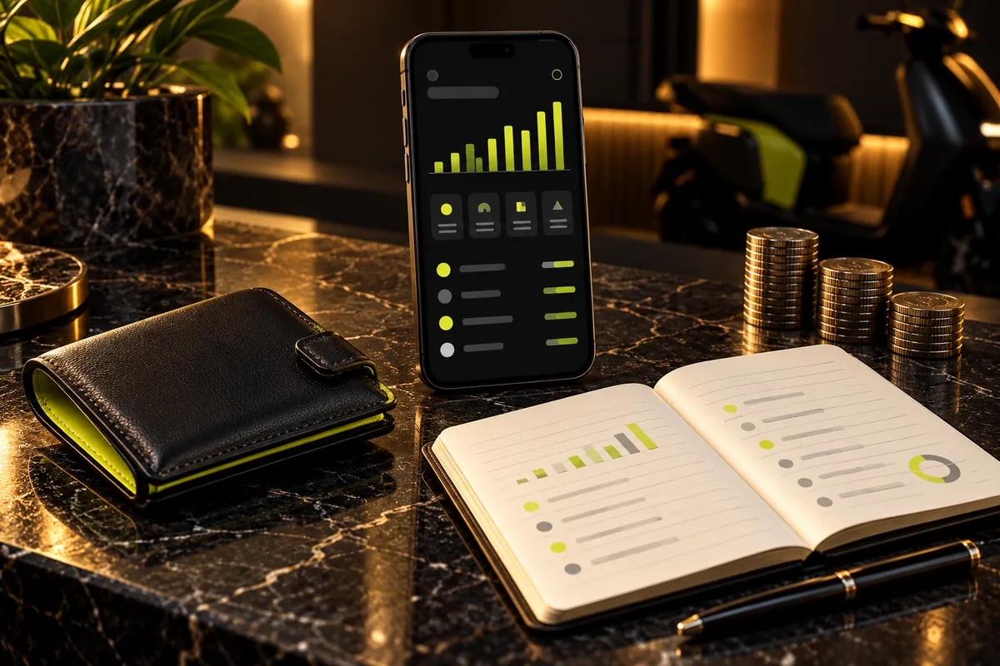

Dimensions: 1200 x 800.

Generation prompt:

~~~text
Create one finished V.Go Captain website artwork. Use the existing reference artwork visible in the conversation as STYLE REFERENCES only: premium photorealistic advertising / physically rendered 3D, convincing textured materials, warm amber rim lighting, deep near-black #030407 shadows, selective vivid lime-yellow #DCE01E accents, elegant modern Egyptian scooter brand. Match its polished realism and restrained palette. No text, letters, numerals, logos, watermarks or signatures anywhere; any screen or paper uses only simple abstract bars, icons and unlabelled graphics.
Use case: product-mockup. Landscape 1200x800, 3:2 composition. A captain's beautifully organised accounts shown as an editorial still life on a black marble desk: black leather wallet with lime-yellow lining at left, an upright black smartphone in the middle with a clean abstract earnings dashboard consisting of unlabeled lime bars and simple separated transaction blocks, an open cream notebook in the foreground right with neatly arranged abstract ruled entries and a small unlabelled chart, black pen beside it, a few small orderly stacks of generic metallic coins without inscriptions. All three primary objects clearly readable and fully within frame. Match the existing feature-earnings image's tactile leather, veined dark stone and warm cinematic light, but make the phone prominent as a distinct object. No actual writing, numbers, currency symbols or lettering on phone, paper, wallet, pen or coins.
~~~

### feature-notifications.webp

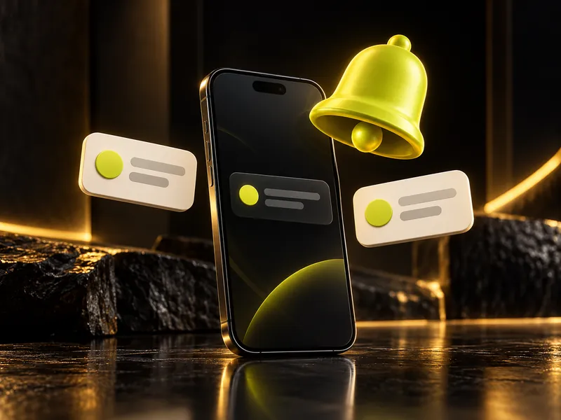

Dimensions: 800 x 600.

Generation prompt:

~~~text
Create one finished V.Go Captain website artwork. Use the existing reference artwork visible in the conversation as STYLE REFERENCES only: premium photorealistic advertising / physically rendered 3D, convincing textured materials, warm amber rim lighting, deep near-black #030407 shadows, selective vivid lime-yellow #DCE01E accents, elegant modern Egyptian scooter brand. Match its polished realism and restrained palette. No text, letters, numerals, logos, watermarks or signatures anywhere; any screen or paper uses only simple abstract bars, icons and unlabelled graphics.
Use case: product-mockup. Landscape 800x600, 4:3 composition. A dimensional lime-yellow notification bell floats prominently above a premium upright black smartphone on a subtly reflective dark studio surface. Two elegant cream message cards hover beside the phone, each with a small lime circular icon and two abstract grey rounded placeholder bars, no lettering. The phone screen is deep charcoal with a simple abstract notification card and lime indicator. Match feature-collection's physical sculptural icons, curved black glass phone, warm amber rim lighting and nearly black studio background. Cohesive luxurious realistic 3D product photography, restrained props, centered balanced framing and comfortable margins. Entire bell visible, no cropped card edges, no red badges, no words, no numerals.
~~~

### feature-verification.webp


Dimensions: 800 x 600.

Generation prompt:

~~~text
Create one finished V.Go Captain website artwork. Use the existing reference artwork visible in the conversation as STYLE REFERENCES only: premium photorealistic advertising / physically rendered 3D, convincing textured materials, warm amber rim lighting, deep near-black #030407 shadows, selective vivid lime-yellow #DCE01E accents, elegant modern Egyptian scooter brand. Match its polished realism and restrained palette. No text, letters, numerals, logos, watermarks or signatures anywhere; any screen or paper uses only simple abstract bars, icons and unlabelled graphics.
Use case: product-mockup. Landscape 800x600, 4:3 composition. A small tidy stack of generic cream identity documents and an ID-sized card on a dark stone plinth, paired with a substantial upright charcoal shield with lime-yellow rim and a single clear raised lime check mark. The generic ID has a small abstract portrait silhouette and simple grey rounded placeholder bars only, clearly an illustrative identity document with no authentic national insignia, numbers or text. Shield in foreground right, documents on left, softly lit black backdrop, warm amber highlights and realistic matte metal and thick paper textures. Match the existing feature-collection sculptural 3D realism and feature-earnings dark materials. Balanced premium product still life, all important shapes fully visible with breathing room.
~~~

### step-download.webp

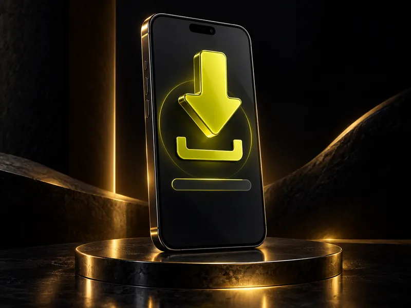

Dimensions: 800 x 600.

Generation prompt:

~~~text
Create one finished V.Go Captain website artwork. Use the existing reference artwork visible in the conversation as STYLE REFERENCES only: premium photorealistic advertising / physically rendered 3D, convincing textured materials, warm amber rim lighting, deep near-black #030407 shadows, selective vivid lime-yellow #DCE01E accents, elegant modern Egyptian scooter brand. Match its polished realism and restrained palette. No text, letters, numerals, logos, watermarks or signatures anywhere; any screen or paper uses only simple abstract bars, icons and unlabelled graphics.
Use case: product-mockup. Landscape 800x600, 4:3 composition. A sleek upright black smartphone at a slight three-quarter angle on a dark reflective studio pedestal, with one large sculptural lime-yellow downward download arrow suspended above the screen and pointing toward a simple matching download tray icon on the screen. Screen charcoal with a subtle lime circular halo and a single empty rounded progress bar; no app store branding, words, numbers or letters. Arrow visibly reads as DOWNWARD DOWNLOAD, not upward. Match the existing feature-collection image: tactile black glass, softly beveled lime icon, warm gold edge lights, deep black atmospheric studio backdrop. Elegant premium 3D advertising realism with gentle surface reflections and generous margin around phone and arrow.
~~~

### step-first-trip.webp

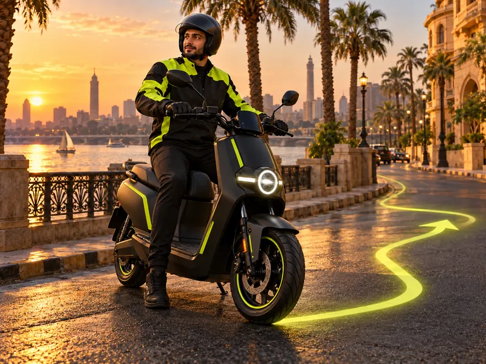

Dimensions: 800 x 600.

Generation prompt:

~~~text
Create one finished V.Go Captain website artwork. Use the existing reference artwork visible in the conversation as STYLE REFERENCES only: premium photorealistic advertising / physically rendered 3D, convincing textured materials, warm amber rim lighting, deep near-black #030407 shadows, selective vivid lime-yellow #DCE01E accents, elegant modern Egyptian scooter brand. Match its polished realism and restrained palette. No text, letters, numerals, logos, watermarks or signatures anywhere; any screen or paper uses only simple abstract bars, icons and unlabelled graphics.
Use case: ads-marketing. Landscape 800x600, 4:3 composition. A young adult Egyptian male scooter captain wearing a correctly fastened black open-face helmet, lime-yellow and black riding jacket, black trousers and gloves is seated ready to depart on a modern matte-black seated electric motor scooter with lime accents on a calm Cairo riverside street. Three-quarter view, both wheels and helmet fully visible. A subtle luminous lime navigation path starts beside the front wheel and winds naturally into the street ahead with a simple arrow shape, no writing. Cairo palms, warm stone architecture and a glimpse of the Nile in soft background focus. Golden-hour cinematic light as in hero-cairo-captain, natural human anatomy, confident calm expression, both hands on handlebars, one foot touching the ground while stationary. Premium photorealistic commercial image, not cartoon, not a standing kick scooter.
~~~

Follow-up edit prompt:

~~~text
Use case: precise-object-edit. Input image is the edit target. Preserve this exact image, its composition, dimensions, lighting, colors, subject, background and all materials. Remove ALL tiny lettering, logos, emblems, brand badges and pseudo-text from the scooter body panels and helmet if present. Specifically leave the front scooter panel and rear side panel completely plain black except their existing lime geometric stripes; leave helmet plain black without any front forehead badge. Replace only these tiny markings with matching clean textured surfaces. No text, no letters, no numerals, no logos anywhere. Everything else unchanged.
~~~

### step-verification.webp

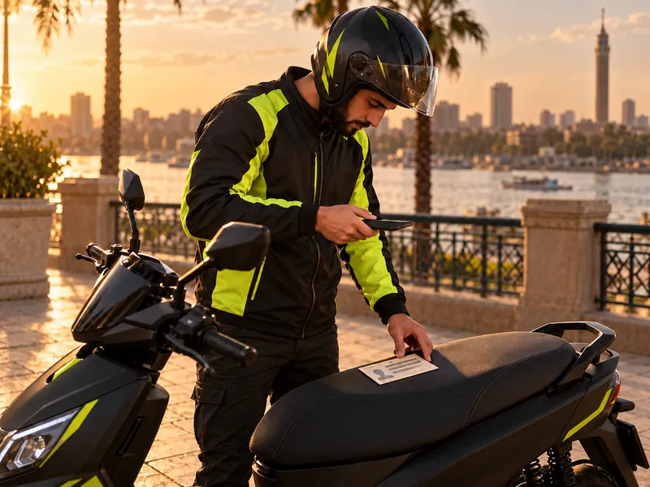

Dimensions: 800 x 600.

Generation prompt:

~~~text
Create one finished V.Go Captain website artwork. Use the existing reference artwork visible in the conversation as STYLE REFERENCES only: premium photorealistic advertising / physically rendered 3D, convincing textured materials, warm amber rim lighting, deep near-black #030407 shadows, selective vivid lime-yellow #DCE01E accents, elegant modern Egyptian scooter brand. Match its polished realism and restrained palette. No text, letters, numerals, logos, watermarks or signatures anywhere; any screen or paper uses only simple abstract bars, icons and unlabelled graphics.
Use case: ads-marketing. Landscape 800x600, 4:3 composition. A young adult Egyptian male captain in a lime-yellow and black riding jacket and securely fastened black helmet stands next to his safely parked matte-black electric seated scooter with lime accents on a Cairo corniche. He is carefully photographing a generic cream identity document resting flat on the scooter seat: one hand holds a black smartphone aimed clearly DOWN at the document, the other steadies the document, gaze directed to phone screen. Medium-wide three-quarter side view makes the phone-document relationship unmistakable and shows his helmet, hands, torso, seat and much of scooter. Document has only a small abstract silhouette and grey placeholder bars, no text or numbers. Realistic correct hands, natural posture. Warm Egyptian stone facade and palms softly blurred behind, Nile ambience, golden late-afternoon light matching hero-cairo-captain. Premium cinematic photographic realism, no floating interface.
~~~

Follow-up edit prompt:

~~~text
Use case: precise-object-edit. Input image is edit target. Keep this exact image, composition, captain identity, scooter, document, background, colors and lighting. Correct only two details: REMOVE the tiny invented lettering on the transparent helmet visor and any tiny logos on clothing, leaving clear glass and plain material. Tilt the smartphone and its holding hand so the phone lies almost horizontally parallel to the document on the scooter seat, rear camera facing down toward the document and screen facing up toward captain's eyes, anatomically natural grip. It must clearly be photographing the document. Document stays abstract bars and silhouette with no text. No text, letters, numerals or logos anywhere. Preserve the rest exactly.
~~~

### og-captain.jpg

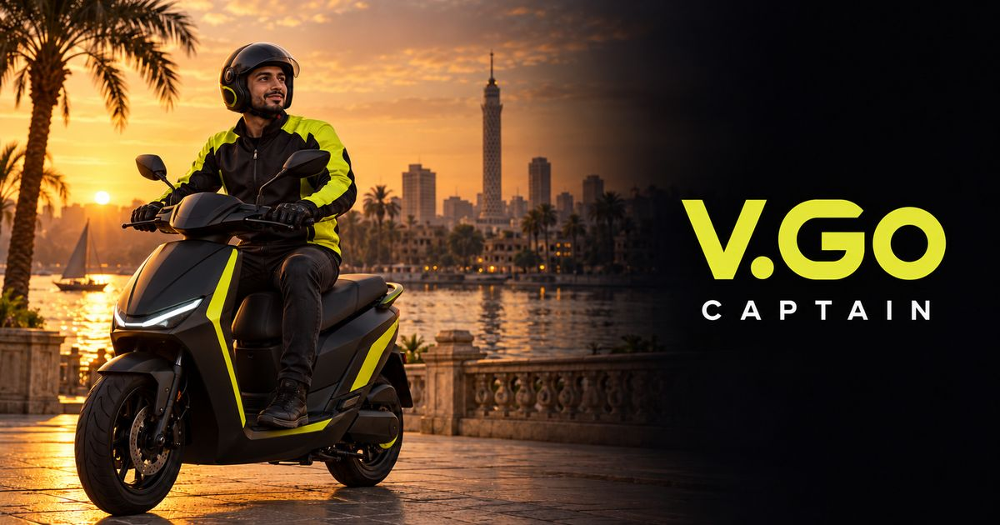

Dimensions: 1200 x 630.

Generation prompt:

~~~text
Create one finished V.Go Captain Open Graph share artwork. Use the original attached hero-cairo-captain as a STYLE REFERENCE: premium photorealistic Egyptian scooter advertising, cinematic amber sunset, deep near-black #030407, vivid lime-yellow #DCE01E accents, detailed textured materials. Use case: ads-marketing. Wide landscape 1200x630, 40:21 composition. On the left half a young adult Egyptian male captain wearing a fastened black helmet and lime-yellow/black riding jacket sits on a premium matte-black seated electric motor scooter with lime-yellow details, by the Nile in Cairo, palms, refined warm stone architecture and distant Cairo Tower. Compose the entire helmet and most of scooter clearly within the wide frame with generous safe margins. Right half is clean nearly-black negative space subtly blended from the evening scene. In this right half include ONLY the exact Latin wordmark "V.Go CAPTAIN", with V.Go large in clean modern bold sans serif lime-yellow and CAPTAIN smaller widely spaced beneath in warm white. Exact capitalization V.Go and CAPTAIN, no extra text and no Arabic anywhere. Elegant restrained brand campaign, highly readable wordmark, no additional logos, labels, captions or watermarks. Avoid any letters or numbers on scooter or clothes.
~~~

Follow-up edit prompt:

~~~text
Use case: precise-object-edit. Input image is edit target. Preserve this exact wide Open Graph artwork, its composition, lighting, captain, scooter, sunset Cairo background and the large right-hand V.Go CAPTAIN wordmark exactly as-is. Remove only the tiny invented logos and text on the helmet forehead, jacket chest and scooter front body panel, replacing with seamless plain black matching surfaces. Leave lime geometric accents intact. The ONLY text in the finished image is the existing large V.Go CAPTAIN wordmark on the right. No other letters, numbers, emblems or pseudo-text. Everything else unchanged.
~~~


## Final asset provenance update - 2026-10-17

Several task outputs and the preceding prompt log appeared during generation. Those files were preserved after inspection. The following records identify the prompts for assets exported by this session and supersede their earlier prompt entries above.

### cta-city-night.webp - final exported version

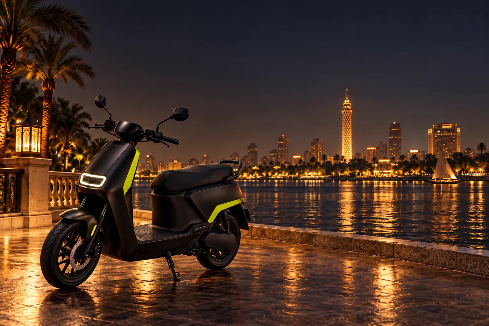

1536 x 1024; WebP quality 80, method 6; 172,206 bytes. Generated and cleaned with the built-in image tool; resized/encoded using Pillow.

Generation prompt:

~~~text
Use case: ads-marketing. Create one premium V.Go Captain website artwork. Match the supplied reference artwork: cinematic photorealistic advertising CGI, physically realistic materials, refined near-black #030407 shadows, vivid lime-yellow #DCE01E accents, warm amber lighting, rich subtle textures, polished modern Egyptian atmosphere. It must look part of the same campaign as the Cairo scooter hero, miniature Cairo navigation scene and black leather wallet still life. No text, no letters, no numbers, no logos, no watermark; any screen or paper uses only clean abstract geometric shapes, lines and symbols. Landscape 3:2 composition, target 1536x1024. A premium matte-black seated electric motor scooter with small lime-yellow body inserts, parked securely on its kickstand on the Cairo Nile corniche at night. Three-quarter view, scooter towards the left of frame, fully visible wheels, realistic proportions. Nile water and elegant illuminated Cairo skyline with recognizable Cairo Tower, palm silhouettes, distant felucca, warm gold reflections, deep charcoal night sky. Open uncluttered space across upper center and right for website overlay. Cinematic luxury commercial photography, believable surroundings, no rider, no signage.
~~~

Cleanup prompt:

~~~text
Use case: precise-object-edit. Edit the supplied image with only this cleanup: remove every tiny brand badge, logo, lettering, pseudo-writing, number and decal from the scooter body, helmet, jacket, gloves, shoes, and background buildings, replacing these marks with seamless plain matching material. Keep all lime decorative geometric body panels. There must be absolutely no text or letters anywhere. Preserve the existing scene, composition, aspect ratio, objects, face, pose, lighting, colors, textures and photographic quality exactly. No other changes.
~~~


## V.Go rider campaign — 17 October 2026

Generated with the built-in image generation tool. Exported with Pillow for dimensions and compression; existing captain artwork preserved. Prompts below are the complete generation prompts.

### hero-vgo-rider.webp

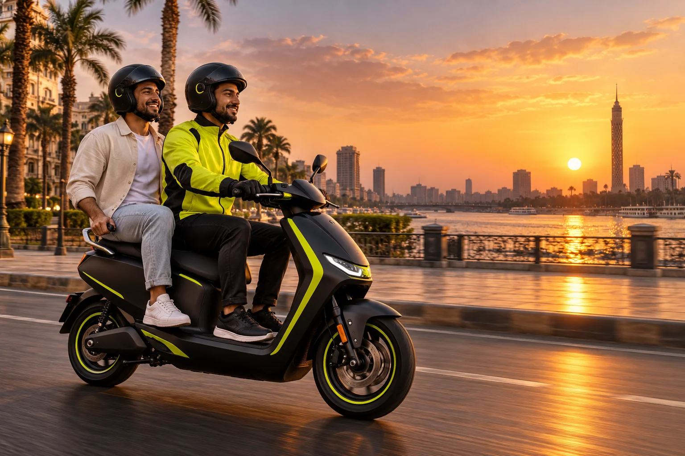

1536 × 1024; 201,128 bytes; quality 85.

```text
Use case: ads-marketing. New premium V.Go rider website hero artwork, landscape 1536x1024. Cinematic photorealistic advertising CGI, matching an Egyptian corniche scooter campaign: deep near-black #030407, lime-yellow #DCE01E details, warm amber sunset, rich realistic materials. Two adult Egyptian men riding one modern matte-black seated electric motor scooter with lime trim along Cairo's Nile corniche: professional captain in lime jacket in front operating handlebars, relaxed smiling passenger in casual cream overshirt seated behind, both wearing fitted safety helmets, passenger feet on passenger footrests and hands holding rear grab rails. Realistic safe seating and anatomy, full scooter and both wheels visible in left half of frame. Palm-lined elegant architecture, Nile and distant Cairo Tower, plenty of calm sky to the right. No text, letters, numbers, logos, watermarks or signage. Show the passenger's enjoyable ride, no phone use while riding.
```

### rider-feature-route.webp

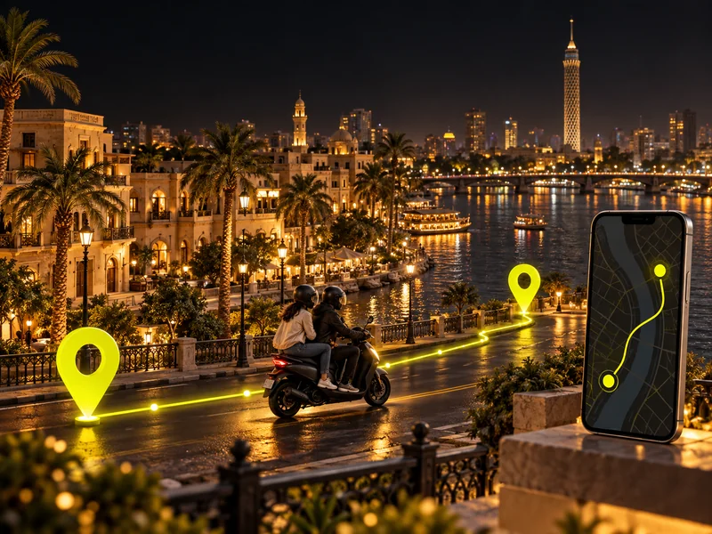

800 × 600; 117,520 bytes; quality 85.

```text
Use case: ads-marketing. New premium V.Go rider website feature image, landscape 4:3. Cinematic finely detailed photorealistic miniature 3D advertising scene, near-black #030407 background, lime-yellow #DCE01E accents, warm amber lights, physically realistic materials, Egyptian visual setting. No text, letters, numbers, logos or watermark. Screens use abstract geometric UI only. A beautiful miniature Cairo Nile corniche with palms, low-rise Egyptian architecture and distant Cairo Tower. Two luminous lime map pins connected by a glowing route, a small matte black seated motor scooter with helmeted captain and passenger midway. A slim phone standing at the edge displays an abstract map with two dots and a route. Communicates route booking and live ride tracking. Rich reflective river, uncluttered composition.
```

### rider-feature-payment.webp

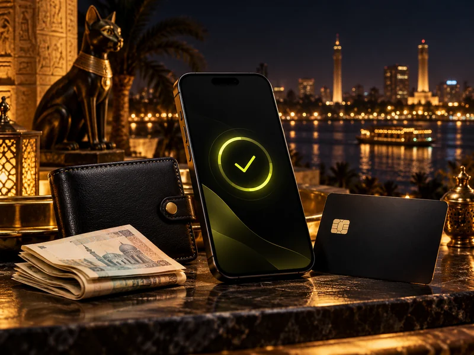

800 × 600; 77,172 bytes; quality 85.

```text
Use case: ads-marketing. New premium V.Go rider website feature image, landscape 4:3. Cinematic finely detailed photorealistic miniature 3D advertising scene, near-black #030407 background, lime-yellow #DCE01E accents, warm amber lights, physically realistic materials, Egyptian visual setting. No text, letters, numbers, logos or watermark. Screens use abstract geometric UI only. Premium still life of a matte black smartphone, a blank black bank card with metallic chip and no numbers, black leather wallet and a few neatly folded generic unmarked banknotes. Abstract lime circular check symbol on screen. Subtle out-of-focus Cairo corniche lights in background. Communicates cash, card and mobile wallet payment choices, elegant product photography, no currency symbols or lettering.
```

### rider-feature-offers.webp

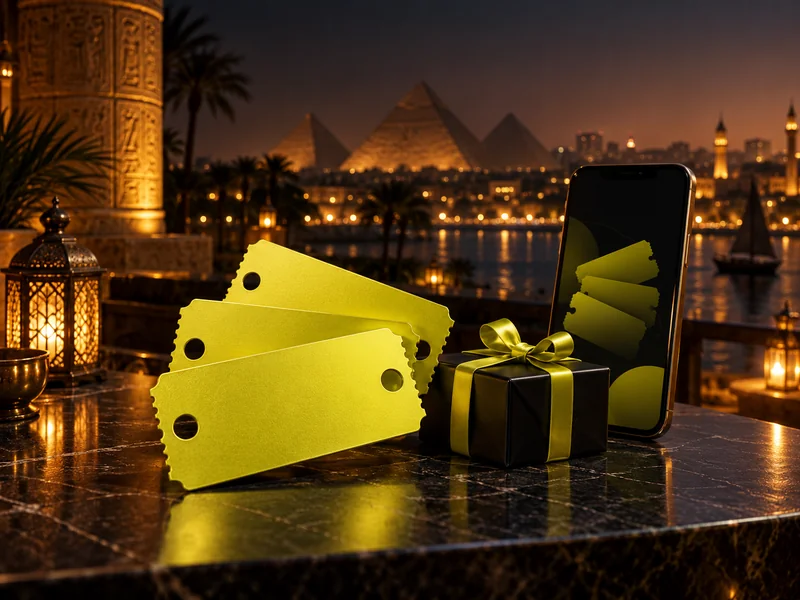

800 × 600; 67,558 bytes; quality 85.

```text
Use case: ads-marketing. New premium V.Go rider website feature image, landscape 4:3. Cinematic finely detailed photorealistic miniature 3D advertising scene, near-black #030407 background, lime-yellow #DCE01E accents, warm amber lights, physically realistic materials, Egyptian visual setting. No text, letters, numbers, logos or watermark. Screens use abstract geometric UI only. Premium still life of three sculptural lime-yellow offer tickets with rounded perforated edges, a small elegant black gift box with lime ribbon, beside a matte black phone displaying abstract ticket silhouettes. Tickets have simple circular cutouts only, no symbols or writing. Warm Cairo evening bokeh, polished dark stone surface, cinematic commercial product photography, generous negative space.
```

### rider-step-account.webp

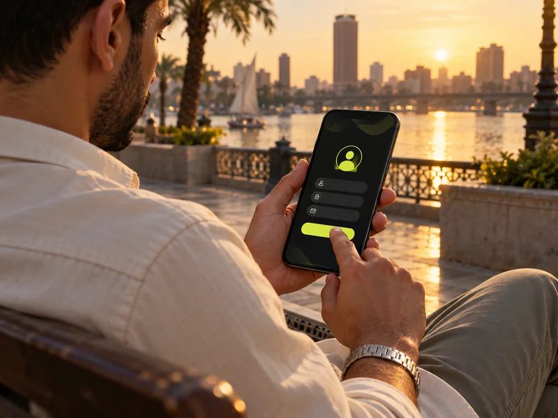

800 × 600; 49,980 bytes; quality 85.

```text
Use case: ads-marketing. New premium V.Go rider website step illustration, landscape 4:3. Cinematic photorealistic advertising CGI, refined near-black #030407 shadows, lime-yellow #DCE01E details, warm amber lighting, realistic materials. Egyptian Nile corniche campaign style. No text, letters, numbers, logos, watermarks or signage; any screen has only abstract shapes and symbols. Close view of an adult Egyptian passenger in a cream overshirt seated on a corniche bench, using their smartphone to create an account. Focus on natural hands and phone screen showing a simple lime avatar circle and three clean input lines and a lime button without text. Soft Nile reflections and palms behind, relaxed warm daylight, professional lifestyle photograph.
```

### rider-step-book.webp

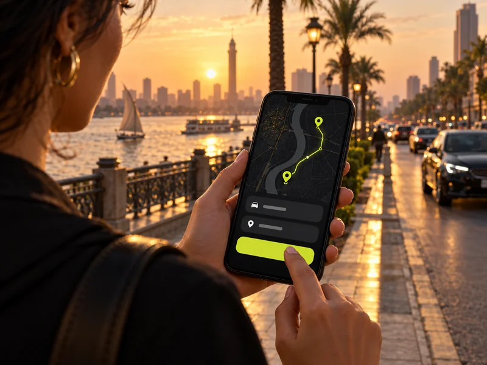

800 × 600; 54,944 bytes; quality 85.

```text
Use case: ads-marketing. New premium V.Go rider website step illustration, landscape 4:3. Cinematic photorealistic advertising CGI, refined near-black #030407 shadows, lime-yellow #DCE01E details, warm amber lighting, realistic materials. Egyptian Nile corniche campaign style. No text, letters, numbers, logos, watermarks or signage; any screen has only abstract shapes and symbols. Over-the-shoulder close-up of an adult Egyptian passenger standing safely on the sidewalk using a matte black phone. Phone shows an abstract dark map with two lime pins connected by a route, two blank fare summary bars and a lime confirmation button. Elegant palm-lined Cairo corniche and softly blurred street in background. Natural hands, clear focus on choosing pickup and destination, warm sunset.
```

### rider-step-meet.webp

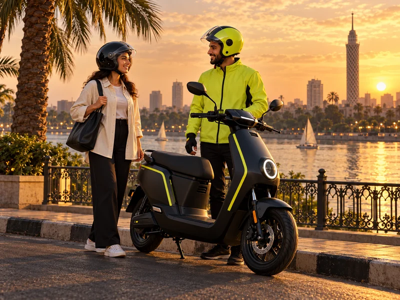

800 × 600; 115,652 bytes; quality 85.

```text
Use case: ads-marketing. New premium V.Go rider website step illustration, landscape 4:3. Cinematic photorealistic advertising CGI, refined near-black #030407 shadows, lime-yellow #DCE01E details, warm amber lighting, realistic materials. Egyptian Nile corniche campaign style. No text, letters, numbers, logos, watermarks or signage; any screen has only abstract shapes and symbols. An adult Egyptian passenger in a cream overshirt and a fitted black helmet smiling as they meet their captain beside a stationary matte black seated electric motor scooter with lime trim, securely on its kickstand on a Cairo corniche curb. Captain in lime jacket and helmet, both standing beside scooter, natural welcoming interaction. Nile, palms and Cairo Tower softly visible. No handshakes needed, anatomically realistic people, warm sunset.
```

### og-vgo.jpg

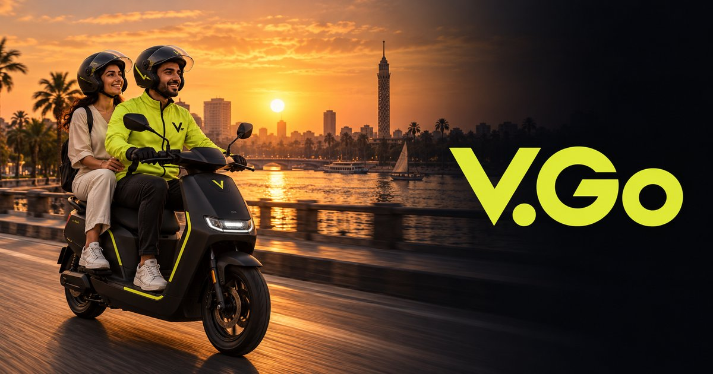

1200 × 630; 125,207 bytes; quality 85.

```text
Use case: ads-marketing. Create a premium wide social sharing image for V.Go, aspect ratio 1200:630. Cinematic photorealistic advertising CGI, charcoal #030407, lime-yellow #DCE01E, warm Egyptian sunset. Left half: matte black seated electric motor scooter with subtle lime trim, adult Egyptian captain in lime jacket in front and adult passenger in cream casual clothes seated behind, both in fitted helmets, safely riding along the Nile corniche with Cairo Tower and palms in distance. Right half: large precise Latin wordmark 'V.Go' in clean bold modern geometric sans serif, lime-yellow, with generous dark negative space. Exact sole text: V.Go. No other text, no Arabic, no slogan, no numbers, no watermark. Premium balanced editorial composition, all subjects safely within frame.
```

### rider-icon.png

512 × 512; 15,468 bytes. Copied and resized from `V-Go/assets/images/icon.png`, the rider brand mark matching the Android launcher. Not generated; no prompt.
